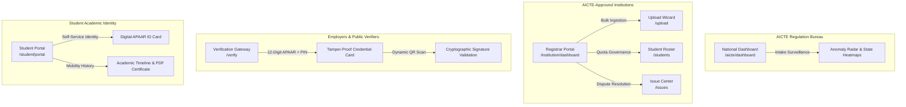

# APAAR Student Data Management & Verification Platform

[](https://www.sih.gov.in/)
[](https://www.aicte-india.org/)
[](https://www.aicte-india.org/)
[](file:///c:/SIH_PS_2/frontend/src/test/)
[](file:///c:/SIH_PS_2/frontend/)

> **All India Council for Technical Education (AICTE) — Regulation Bureau**  
> **Problem Statement 26263:** Centralized APAAR ID-Based Student Data Management, Intake Quota Monitoring, and Verifiable Academic Registry.

---

## 📌 Executive Summary

Under the **National Education Policy (NEP 2020)** and the **One Nation, One Student ID** initiative, the Automated Permanent Academic Account Registry (**APAAR**) provides a lifelong 12-digit digital identifier for every student in India.

This platform provides an authoritative, sovereign digital registry for AICTE-approved institutions and regulatory bureaus to:
1. **Anchor Enrolments to 12-Digit APAAR IDs:** Eliminate ghost admissions, duplicate student registrations, and unapproved enrollments.
2. **Monitor Intake Compliance in Real Time:** Track admissions against approved institutional and branch-level intake quotas.
3. **Detect & Resolve Multi-Institution Anomalies:** Flag cross-institution duplicate enrollments with evidence-backed dispute workflows.
4. **Deliver Instant, Verifiable Academic Verification:** Provide a public, tamper-evident verification gateway using HMAC-SHA256 signatures, dynamic QR codes, and DPDP Act 2023 privacy guardrails.

---

## 🏛️ Ecosystem Architecture & Stakeholder Portals

The platform delivers dedicated interfaces for all four foundational ecosystem stakeholders:



### 1. Institution Administrator Portal (`/institution/dashboard`)
* **Intake Progress Gauges:** Live visual progress meters monitoring real-time admissions against AICTE-sanctioned seats (e.g., *118 / 120 filled, 2 remaining*).
* **"What Needs Fixing" Action Hub:** High-priority resolution cards for flagged records (missing APAAR IDs, category mismatches, transfer certificates pending).
* **Bulk Upload Wizard (`/upload`):** 3-step CSV ingestion engine with instant client-side pre-validation (242 valid vs 8 flagged), row error table, and downloadable fix CSV.
* **Student Registry (`/students`):** Filterable master roster with masked APAAR IDs (`•••• •••• 9012`) adhering to privacy guidelines.
* **Dispute Center (`/issues`):** Resolution dialogs for multi-institution conflict triage, category corrections, and document approvals.
* **Intake & Quota Reports (`/reports`):** Category-wise distribution (General, OBC, SC, ST, EWS) with CSV export.

### 2. AICTE Regulation Bureau Portal (`/aicte/dashboard`)
* **Pan-India Surveillance Radar:** Macro-level monitoring across 4,200+ approved technical institutes and 1.8M+ student records.
* **State-Wise Heatmap & Filters:** Dynamic drilldowns across states, universities, and program types (Engineering, Management, MCA).
* **Intake Utilization Meters:** National seat fill rates, over-intake warnings, and ghost enrollment detection.
* **Flagged Anomaly Feeds:** Contextual flagging of repeated APAAR IDs across different universities.

### 3. Public & Corporate Verification Gateway (`/verify`)
* **12-Digit Search & Consent PIN:** Secure verification requiring student consent PIN under DPDP Act 2023 regulations.
* **Tamper-Evident Digital Credential Card:** Verified institution, course, academic session, roll number, and admission status.
* **Dynamic QR Code Verification:** Live SVG/Canvas QR containing HMAC-SHA256 signature payload for instant mobile scanner verification.
* **Demo Preset Button:** 1-click evaluator test button preloading synthetic demo student *Asha K.* (`9823-4567-8901`).

### 4. Student Academic Identity Portal (`/student/portal`)
* **Digital Sovereign APAAR ID Card:** High-contrast, printable card featuring national emblems, student portrait, and QR code.
* **Academic Mobility Timeline:** Verified progression from Higher Secondary to B.Tech Computer Engineering.
* **Tamper-Evident PDF Certificate:** 1-click client-side download of certified academic enrollment statement.
* **Discrepancy Reporting:** Self-service issue reporting for data corrections with registrar notification.

---

## ⚡ Key Innovations & Technical Highlights

* **1-Click Evaluator Test Profiles:** High-contrast login interface (`/login`) featuring instant 1-click preset switches for SIH evaluators across all 4 roles (Registrar, AICTE Regulator, Corporate Verifier, and Student).
* **Modern Regional Language Switcher:** Sleek dropdown component supporting **8 Indian languages** (English, हिन्दी, मराठी, தமிழ், తెలుగు, বাংলা, ગુજરાતી, ಕನ್ನಡ) with dual-mode styling (`variant="dark"` for sovereign navy headers and `variant="light"` for white dashboard shells).
* **DPDP Act 2023 Privacy Compliance:** Automatic masking of 12-digit APAAR numbers in rosters, consent PIN protection on public verification lookups, and clear data minimization disclaimers.
* **Pre-Wired REST Client & Synthetic Mock Engine:** Typed REST client (`frontend/src/services/api.ts`) matching `docs/API-CONTRACTS.md` with seamless offline fallback adapter (`services/mockData.ts`) providing realistic synthetic fixtures.
* **Unified Design System:** Pixel-perfect typography using `Inter` and `JetBrains Mono` for 12-digit APAAR formatting, responsive mobile navigation drawer, and animated route transitions.

---

## 🛠️ Technology Stack

| Layer | Technology | Details |
|---|---|---|
| **Framework** | React 18 (`18.3.1`) | Functional components, Hooks, StrictMode |
| **Language** | TypeScript 5 (`5.5.4`) | Strict type checking, zero `any` leaks |
| **Build Tool** | Vite 5 (`5.4.21`) | Lightning-fast HMR, optimized production chunks |
| **Styling** | Tailwind CSS 3 (`3.4.10`) | Custom sovereign theme (`#0B3C88`), responsive design |
| **Icons** | Lucide React (`0.441.0`) | Semantic, accessible SVG icons |
| **Routing** | React Router v6 (`6.26.2`) | Layout wrappers, declarative navigation, route guards |
| **QR Generation** | `qrcode` (`1.5.4`) | Dynamic high-density canvas/SVG generation |
| **CSV Parsing** | `papaparse` (`5.4.1`) | High-speed streaming client-side CSV parsing |
| **Testing** | Vitest (`2.0.5`) + RTL | 14/14 component and workflow tests passing |

---

## 📁 Repository Structure

```
SIH_PS_2/
├── docs/                                # Authoritative Architecture & Specs
│   ├── API-CONTRACTS.md                 # Complete REST API Specification (/api/v1)
│   ├── ARCHITECTURE.md                  # C4 Architecture Diagrams & Module Boundaries
│   ├── DATA-MODEL.md                    # Relational Schema & Enum Definitions
│   ├── DECISIONS.md                     # Architecture Decision Records (ADRs)
│   ├── IMPLEMENTATION-PLAN.md           # Phased Delivery Roadmap
│   ├── PRD.md                           # Product Requirements Document
│   ├── PROGRESS.md                      # Live Session Progress Log
│   ├── SECURITY.md                      # DPDP Act 2023 & GIGW 3.0 Compliance Guide
│   ├── SIH-DEMO-AND-PITCH-GUIDE.md      # 5-Minute Jury Pitch & Live Demo Script
│   ├── TEAM-OWNERSHIP.md                # 6-Member RACI Ownership Matrix
│   ├── UI-DESIGN-AND-WORKFLOWS.md       # Master UI System, 12 Pages & 6 Flows
│   ├── VALIDATION-RULES.md              # 12-Digit APAAR & Quota Validation Rules
│   └── members/                         # Individual Member Briefs
│       └── MEMBER-1-FRONTEND.md         # Member 1 (Frontend & UX) Brief
├── frontend/                            # React + TypeScript + Vite Application
│   ├── src/
│   │   ├── components/
│   │   │   ├── common/                  # Reusable UI Primitives (Button, Badge, Modal, LanguageSwitcher)
│   │   │   └── layout/                  # PublicLayout.tsx, AppShell.tsx, Sidebar.tsx
│   │   ├── context/                     # AuthContext.tsx, NotificationContext.tsx
│   │   ├── pages/                       # 12 Feature Pages (Home, Dashboard, Upload, Verify, etc.)
│   │   ├── services/                    # Typed API Client & Synthetic Mock Data Adapter
│   │   └── test/                        # Vitest Test Suites (App, Dashboard, Upload, Verify)
│   ├── package.json
│   ├── tailwind.config.js
│   ├── tsconfig.json
│   └── vite.config.ts
├── AGENTS.md                            # AI Pair Programming Operating Protocol
└── README.md                            # Master Project Overview (This File)
```

---

## 🚀 Getting Started

### Prerequisites
* **Node.js**: v18.0.0 or higher (v20+ recommended)
* **npm**: v9.0.0 or higher

### 1. Clone the Repository
```bash
git clone https://github.com/mohit-krishnani/APAAR-Student-Data-Management-and-Verification-Platform.git
cd SIH_PS_2
```

### 2. Install Dependencies
```bash
cd frontend
npm install
```

### 3. Start the Development Server
```bash
npm run dev
```
The application will launch on:
* **Local:** [http://localhost:3000/](http://localhost:3000/)
* **Alternative Local:** [http://127.0.0.1:3000/](http://127.0.0.1:3000/)

### 4. Run the Test Suite
```bash
npm test
```
Runs 14 Vitest unit tests verifying app shell rendering, dashboard metrics, 3-step bulk upload stepper, and cryptographic verification flow.

### 5. Compile Production Bundle
```bash
npm run build
```
Generates optimized, tree-shaken static assets in `frontend/dist/`.

---

## 🗺️ Route Directory

| Path | Purpose | Stakeholder / Access |
|---|---|---|
| `/` | Sovereign Public Portal, Stakeholder Grid, Stats Ticker | Public / All |
| `/login` | Multi-Role Authentication with 1-Click Demo Profiles | Public / Evaluators |
| `/register` | "Who Are You?" Multi-Role Identity Onboarding | Public / New Users |
| `/institution/dashboard` | Sanctioned vs Actual Intake Meters, "What Needs Fixing" | Institution Admin |
| `/upload` | 3-Step Bulk CSV Ingestion & Pre-Validation Wizard | Institution Admin |
| `/students` | Master Student Registry with Masked APAAR Lookups | Institution Admin |
| `/issues` | Multi-Institution Conflict & Document Resolution Hub | Institution Admin |
| `/reports` | Intake Utilization & Reservation Quota Analytics | Institution Admin |
| `/aicte/dashboard` | Pan-India Surveillance Radar & State Intake Heatmaps | AICTE Bureau Admin |
| `/verify` | Tamper-Evident Verification with Live QR & Signature | Public / Corporate |
| `/student/portal` | Sovereign Digital APAAR Card & Mobility History | Student |
| `/api-docs` | Interactive REST API & ERP Integration Sandbox | Developers / ERP Partners |
| `/help` | Regulatory FAQs, GIGW Guidelines & Support Helpdesk | Public / All |

---

## 🔒 Compliance & Security Principles

* **DPDP Act 2023 Alignment:** APAAR IDs are masked in rosters (`•••• •••• 9012`). Public lookups require student consent PIN authorization.
* **Synthetic Development Fixtures:** No real student personal identifiable information (PII) is stored or displayed; synthetic fixtures are utilized for all demos and tests.
* **Non-Simulated Government Credentials:** All government identity hooks are explicitly labelled as mock adapters until official DigiLocker/UIDAI production credentials are supplied.
* **Contextual Anomaly Classification:** Repeated APAAR IDs trigger review and resolution states—never automated disqualification.

---

## 👥 Team & Ownership

This project is built for **SIH 2026 Problem Statement 26263**. Team ownership is partitioned as follows:
* **Member 1 (Frontend & UX Lead):** UI/UX Design System, 4 Stakeholder Portals, 12 Core Pages, Language Switcher, Vitest Component Tests.
* **Member 2 (Backend & DB Lead):** FastAPI REST Backend, PostgreSQL Relational Schema, Intake Validation Engine, Database Migrations.
* **Member 3 (APAAR & Anomaly Lead):** APAAR Verification Adapter, Multi-Institution Duplicate Detector, Transfer Certificate Tracking.
* **Member 4 (Security & Integration Lead):** Role-Based Access Control (RBAC), JWT Authentication, DPDP Compliance, API Gateway.
* **Member 5 (DevOps & Deployment Lead):** Docker Containerization, CI/CD Pipelines, Cloud Infrastructure, Reverse Proxy.
* **Member 6 (QA & Documentation Lead):** End-to-End Integration Tests, Compliance Verification, Technical Manuals & Presentation.

For detailed RACI breakdowns, see [`docs/TEAM-OWNERSHIP.md`](docs/TEAM-OWNERSHIP.md).

---

## 📄 License & Intellectual Property

Developed for the **Smart India Hackathon (SIH 2026)** under the auspices of the **All India Council for Technical Education (AICTE)**, Ministry of Education, Government of India.
