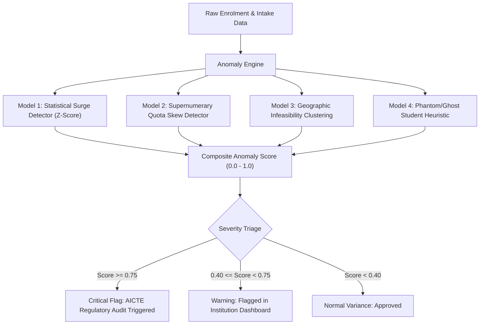

# Intelligent Anomaly Detection Specification

## 1. Purpose & Innovation Context
AICTE SIH Problem Statement 26263 states:
> *"Innovation Expected: The solution should go beyond simple data collection by providing automated validation, intelligent anomaly detection, real-time monitoring, secure verification, and analytics, thereby creating a reliable national-level student data ecosystem."*

While deterministic validation (`VALIDATION-RULES.md`) catches binary violations (such as missing fields, duplicate APAAR in a CSV, or exceeding intake by 1 student), **Intelligent Anomaly Detection** uncovers systemic irregularities, gaming of regulatory quotas, and fraudulent enrolment patterns that slip past simple threshold checks.

---

## 2. Anomaly Detection Models

---

### Model 1: Sudden Enrolment Surge / Plunge Detector (Z-Score)
* **Objective:** Detect institutions experiencing an unnatural spike or drop in intake fill rate compared to their 3-year historical baseline and peer institutions in the same state/tier.
* **Mathematical Formula:**
  $$Z = \frac{X_t - \mu_{3yr}}{\sigma_{3yr}}$$
  Where:
  - $X_t$: Current academic year's enrolment count for a programme.
  - $\mu_{3yr}$: Mean enrolment over the previous 3 academic years.
  - $\sigma_{3yr}$: Standard deviation over the previous 3 academic years.
* **Flag Threshold:** $|Z| \ge 2.5$ (indicates a statistically abnormal $\pm 2.5$ standard deviation shift).
* **Advisory Action:** Prompts an AICTE regulatory inspection to verify sudden expansion infrastructure compliance.

---

### Model 2: Supernumerary Seat Quota Skew Detector
* **Objective:** Detect manipulation of reserved supernumerary quotas (NRI, OCI, Foreign National, Tuition Fee Waiver).
* **Vulnerability Identified:** Institutions filling regular quota deficits by falsely registering local students under NRI or special quotas without requisite fee/residency proofs.
* **Algorithm:**
  $$\text{Quota Ratio} = \frac{\text{Enrolled Supernumerary Seats}}{\text{Enrolled Regular Seats}}$$
  - If $\text{Quota Ratio} > \text{Permitted Regulatory Cap} \times 1.2$, trigger `ANOMALY_SUPERNUMERARY_SKEW`.
* **Action:** Prompts the college admin to upload mandatory consular / passport / income verification documents for the flagged batch.

---

### Model 3: Spatiotemporal Travel Infeasibility Detector
* **Objective:** Detect fraudulent dual active enrolments where a single student's APAAR ID is claimed by two regular full-time campus programmes located in distant cities.
* **Algorithm:**
  1. Let Institution $A$ be at coordinates $(lat_A, lon_A)$ and Institution $B$ at $(lat_B, lon_B)$.
  2. Compute Great-Circle Haversine distance $D(A, B)$.
  3. If both enrolments are full-time regular degree programmes and $D(A, B) > 150 \text{ km}$:
     $$\text{Infeasibility Score} = 1.0 \quad (\text{Flagged as Impossible Simultaneous Regular Attendance})$$
* **Resolution Workflow:** The AICTE dashboard highlights this conflict immediately, giving both institutions 7 days to produce biometric attendance or Transfer Certificate confirmation.

---

### Model 4: Phantom / Ghost Student Pattern Detector
* **Objective:** Detect fake student entries created to inflate faculty-to-student ratios or misappropriate scholarship disbursements.
* **Heuristics:**
  - **Batch Ingestion Velocity:** Uploading hundreds of records within 10 minutes of the national deadline cutoff.
  - **Demographic Entropy:** Abnormally low variance in student DOBs (e.g. 80% born in the same month) or sequential synthetic student roll numbers with identical surname patterns.
  - **APAAR Generation Recency:** All APAAR IDs generated within 48 hours of admission deadline.

---

## 3. Composite Anomaly Scoring Formula

For each institution $i$ in academic year $y$:
$$\text{Score}(i) = 0.35 \times S_{\text{surge}} + 0.25 \times S_{\text{quota}} + 0.25 \times S_{\text{spatiotemporal}} + 0.15 \times S_{\text{ghost}}$$

| Score Range | Classification | AICTE Dashboard Presentation | System Action |
|---|---|---|---|
| **0.00 – 0.39** | **Compliant** | Green Shield ("Normal Operations") | Auto-cleared |
| **0.40 – 0.74** | **Moderate Variance** | Yellow Badge ("Advisory Review") | Institution notified; clarification requested |
| **0.75 – 1.00** | **High Anomaly** | Red Pulse Banner ("Regulatory Audit") | Placed on AICTE Inspection Priority List |

---

## 4. Ethical AI & Human-in-the-Loop Safeguards
1. **No Automated Rejection:** Anomaly detection never cancels a student's admission automatically. It is strictly an **advisory intelligence tool** for human regulators.
2. **Transparent Explanations:** Every flagged anomaly provides human-readable reasons (e.g. *"Enrolment jumped from 45 to 118 students without corresponding approved intake expansion"*).
3. **Appeals & Rectification:** Institutions can submit documentary evidence directly through the `/institution/issues` interface to clear anomalies.

