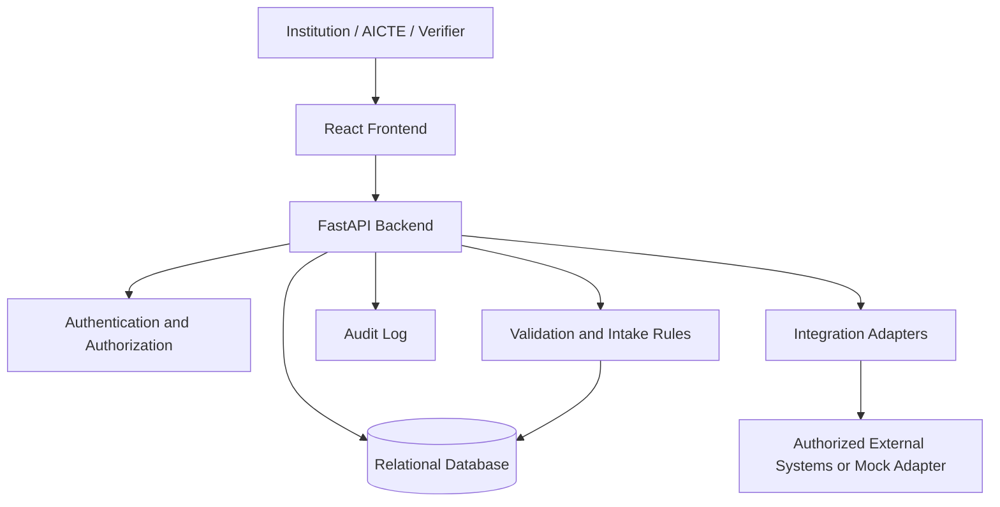

# System Architecture

## 1. Proposed high-level design
- **Frontend:** React web application for AICTE administrators, institution administrators, authorized verifiers, and optionally students.
- **Backend API:** FastAPI service responsible for authentication, authorization, business workflows, validation orchestration, reporting, and verification.
- **Database:** MySQL or PostgreSQL. Confirm the final choice in `DECISIONS.md`.
- **Validation service/module:** Domain logic for identifier checks, duplicate detection, intake comparison, and anomaly flags.
- **Integration adapters:** Interfaces for external institutional systems and authorized APAAR/AICTE integrations. Use mock adapters when real access is unavailable.
- **Audit service/module:** Records sensitive actions and changes.

## 2. Logical flow
1. Institution user authenticates.
2. Frontend submits a student record or bulk-upload file to the API.
3. API validates the user's role and institution scope.
4. Upload parser checks file structure and required columns.
5. Domain validation checks records and creates issues where necessary.
6. Accepted records and issue records are persisted transactionally.
7. Dashboards query authorized aggregates.
8. Verification requests pass through authorization and disclosure rules, then return only allowed fields.
9. Sensitive actions are written to audit logs.

## 3. Module boundaries
### Frontend
Presentation, form state, navigation, accessibility, API client, loading/error/empty states. It must not be the only enforcement point for permissions.

### Backend and data
Authentication, users, institutions, student records, persistence, API contracts, tenant isolation, upload orchestration, audit logs, reporting endpoints.

### Validation and verification
Pure/testable domain rules, duplicate match classification, intake calculations, anomaly explanations, verification references, and validation-related tests. It must use the shared schema and service interfaces.

## 4. Security boundaries
- All private endpoints require authentication.
- Backend authorization is required for every protected resource.
- Institution-scoped queries must enforce institution ownership in the backend.
- Verification endpoints disclose the minimum allowed fields.
- Secrets are loaded from environment variables.
- Do not log full identifiers or unnecessary personal data.
- Use TLS in deployed environments and database encryption controls where available.

## 5. Reliability and error handling
- Bulk upload should return per-row outcomes and not partially corrupt records.
- Use database transactions for related writes.
- API errors should use a consistent response format.
- External integration failures should be distinguishable from invalid student data.
- Avoid silently dropping rows.
- Use pagination for large tables.

## 6. Scale and extensibility
Keep validation rules modular and configurable. Avoid hard-coding intake rules to a single college or academic year. Keep integration adapters separate from core business logic.

## 7. Architecture diagram

