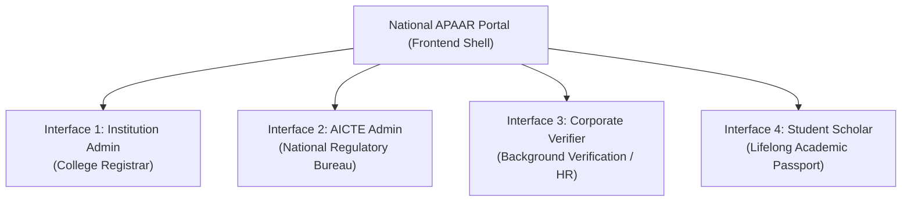
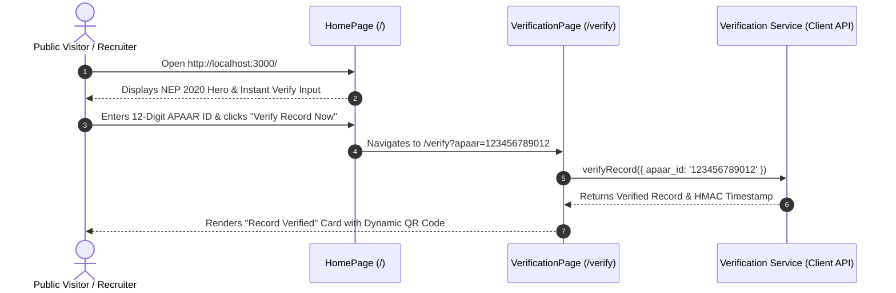
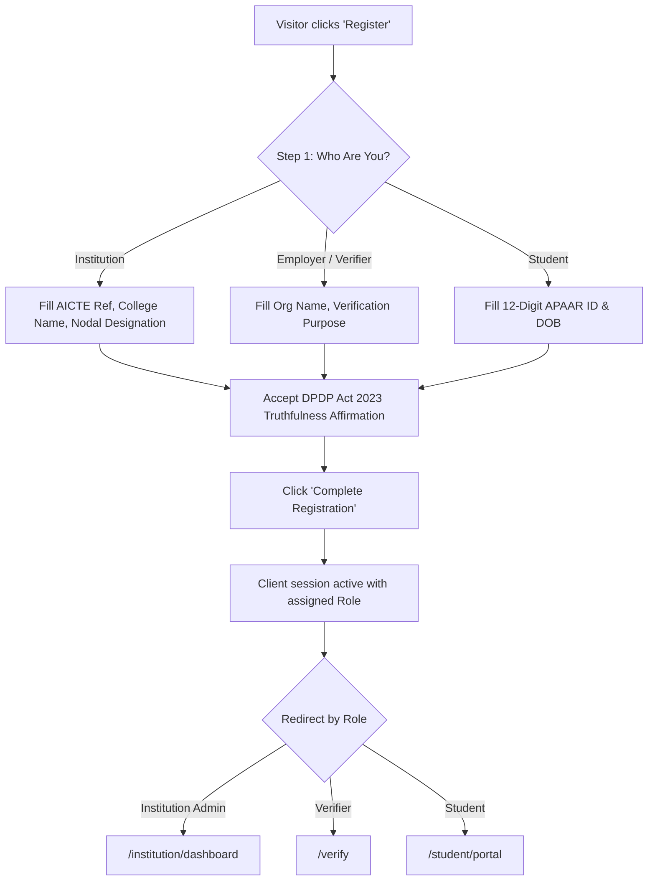
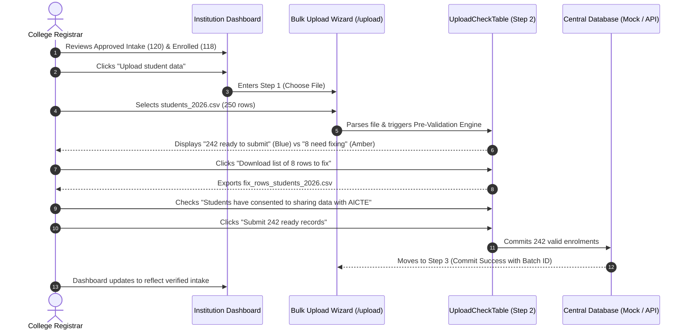
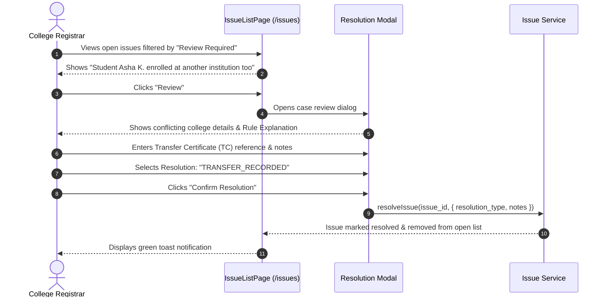
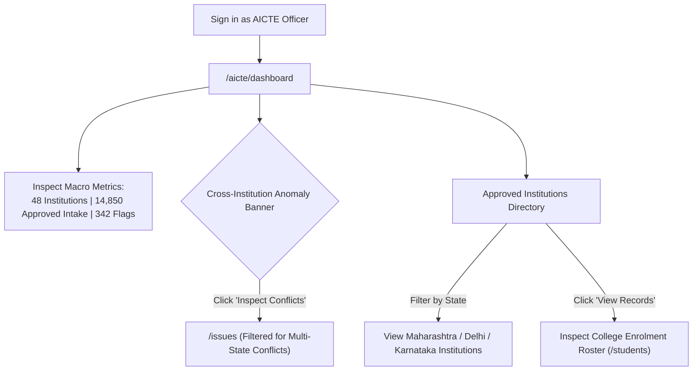
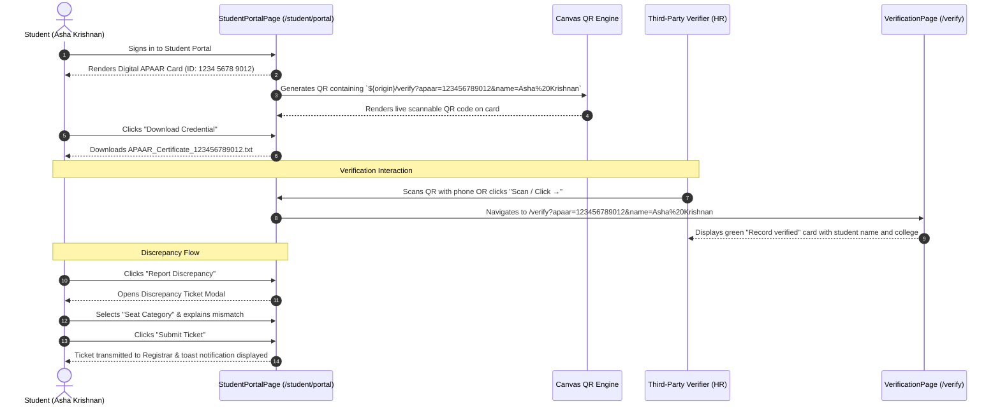

# UI Design, Page Inventory, and User Workflows Specification

**Platform:** APAAR ID-Based Student Data Management and Verification Platform  
**Competition / Problem Statement:** Smart India Hackathon (SIH 2026) — AICTE Problem Statement 26263  
**Standard Compliance:** Guidelines for Indian Government Websites (GIGW 3.0), NEP 2020, DPDP Act 2023  
**Lead Author:** Member 1 (Frontend & UX Lead)  

---

## Table of Contents
1. [Executive Summary & Design Philosophy](#1-executive-summary--design-philosophy)
2. [Design System & Typographical Standards](#2-design-system--typographical-standards)
3. [Global Components & Shell](#3-global-components--shell)
4. [Complete Page Inventory (All 12 Pages)](#4-complete-page-inventory-all-12-pages)
   - [4.1 Public Landing Page (`HomePage.tsx`)](#41-public-landing-page-homepagetsx)
   - [4.2 Authentication & Federated SSO (`LoginPage.tsx`)](#42-authentication--federated-sso-loginpagetsx)
   - [4.3 Multi-Role Registration Portal (`RegisterPage.tsx`)](#43-multi-role-registration-portal-registerpagetsx)
   - [4.4 Institution Dashboard — Mockup 1 (`InstitutionDashboardPage.tsx`)](#44-institution-dashboard--mockup-1-institutiondashboardpagetsx)
   - [4.5 Bulk Admissions Upload Wizard — Mockup 2 (`BulkUploadPage.tsx`)](#45-bulk-admissions-upload-wizard--mockup-2-bulkuploadpagetsx)
   - [4.6 Master Student Roster (`StudentListPage.tsx`)](#46-master-student-roster-studentlistpagetsx)
   - [4.7 Validation & Anomaly Resolution Center (`IssueListPage.tsx`)](#47-validation--anomaly-resolution-center-issuelistpagetsx)
   - [4.8 AICTE National Regulatory Dashboard (`AicteDashboardPage.tsx`)](#48-aicte-national-regulatory-dashboard-aictedashboardpagetsx)
   - [4.9 Sanctioned Intake & Quota Reports (`ReportsPage.tsx`)](#49-sanctioned-intake--quota-reports-reportspagetsx)
   - [4.10 Public & Verifier Record Lookup — Mockup 3 (`VerificationPage.tsx`)](#410-public--verifier-record-lookup--mockup-3-verificationpagetsx)
   - [4.11 Student Academic Identity Portal — 4th Interface (`StudentPortalPage.tsx`)](#411-student-academic-identity-portal--4th-interface-studentportalpagetsx)
   - [4.12 Help & Regulatory Disclosure (`HelpPage.tsx`)](#412-help--regulatory-disclosure-helppagetsx)
5. [End-to-End User Workflows & Journey Diagrams](#5-end-to-end-user-workflows--journey-diagrams)
   - [Workflow 1: Public Visitor & Instant Verification](#workflow-1-public-visitor--instant-verification)
   - [Workflow 2: Multi-Role Onboarding & Federated Sign-In](#workflow-2-multi-role-onboarding--federated-sign-in)
   - [Workflow 3: College Registrar Admissions Ingestion & Over-Intake Guard](#workflow-3-college-registrar-admissions-ingestion--over-intake-guard)
   - [Workflow 4: Cross-Institution Duplicate Enrolment Resolution](#workflow-4-cross-institution-duplicate-enrolment-resolution)
   - [Workflow 5: AICTE Bureau National Surveillance & Anomaly Investigation](#workflow-5-aicte-bureau-national-surveillance--anomaly-investigation)
   - [Workflow 6: Student Credential Mobility, Dynamic QR Verification & Discrepancy Redressal](#workflow-6-student-credential-mobility-dynamic-qr-verification--discrepancy-redressal)
6. [Dynamic QR Code & Verification Architecture](#6-dynamic-qr-code--verification-architecture)
7. [Security, Privacy & DPDP Act 2023 Implementation in UI](#7-security-privacy--dpdp-act-2023-implementation-in-ui)
8. [Component Hierarchy & Client State Architecture](#8-component-hierarchy--client-state-architecture)
9. [Build & Testing Acceptance Metrics](#9-build--testing-acceptance-metrics)

---

## 1. Executive Summary & Design Philosophy

The **APAAR Student Data Management and Verification Platform** serves as the single authoritative digital gateway for technical and higher education institutions in India under the **All India Council for Technical Education (AICTE)** and the **Ministry of Education (MoE)**.

### Core Objectives
1. **Intake Integrity:** Enforce approved institutional intake quotas in real-time, eliminating ghost enrolments and seat over-allocation.
2. **One Nation, One Student ID (NEP 2020):** Anchor all academic admissions to the 12-digit Automated Permanent Academic Account Registry (APAAR) identifier.
3. **Tamper-Evident Verification:** Deliver zero-knowledge, data-minimized instant verification for employers and universities.
4. **Authentic Sovereign Experience (GIGW 3.0):** Embody the visual language, accessibility standards, and institutional credibility of Indian National Portals (India.gov.in, DigiLocker, AICTE India).



---

## 2. Design System & Typographical Standards

The frontend follows an official Indian Government design system compliant with **GIGW 3.0** (Guidelines for Indian Government Websites).

### 2.1 Sovereign Color Palette

| Token | Hex Value | Semantic Usage |
| :--- | :--- | :--- |
| **National Navy** | `#0B3C88` | Primary brand color, navbar, primary action buttons, dark banners |
| **Dark Indigo** | `#071830` | Header text, high-contrast borders, table headers |
| **Saffron / India Gold** | `#FF9933` / `#F59E0B` | Top tricolor strip accent, 1-click CTA buttons, highlights |
| **India Green** | `#138808` / `#059669` | Tricolor accent, verified status badges, active enrolment indicators |
| **Neutral Canvas** | `#F8FAFC` (Slate 50) | Portal background, card backing |
| **Card Fill** | `#FFFFFF` | Form containers, result cards, metric cards |
| **Alert Amber** | `#FDE68A` / `#D97706` | Warning cards (Mockup 1 & 2), attention metric cards |
| **Flagged Rose** | `#FEE2E2` / `#DC2626` | Critical validation issues, over-intake warnings |
| **Border Dark** | `#0F172A` (Slate 900) | 2px solid authoritative borders matching SIH mockups |

### 2.2 Strict Typographical Hierarchy

To ensure uniform scaling across all devices and prevent visual clutter, typography has been strictly standardized across all pages:

| Element | CSS / Tailwind Class | Visual Role | Sample Context |
| :--- | :--- | :--- | :--- |
| **Page Title (`H1`)** | `text-2xl sm:text-3xl font-extrabold text-slate-900 tracking-tight` | Top title on every page | "Welcome, Delhi Institute...", "Verify a student record" |
| **Hero Title** | `text-2xl sm:text-4xl font-extrabold tracking-tight text-white` | Hero title with explicit `style={{ color: '#fff' }}` | Public Home Page hero |
| **Section Title (`H2`)** | `text-xl sm:text-2xl font-bold text-slate-900 tracking-tight` | Major page division | "What needs fixing", "Rows to fix", "Record verified" |
| **Card Header (`H3`)** | `text-base sm:text-lg font-bold text-slate-900` | Sub-card header | "3 records have no APAAR ID", "Current Academic Enrolment" |
| **Primary Metric Figure** | `text-3xl sm:text-4xl font-extrabold tracking-tight text-slate-900` | High-impact numbers | Approved intake: `120`, Enrolled: `118`, Ready: `242` |
| **Body Text** | `text-sm sm:text-base text-slate-700 font-medium leading-relaxed` | Reading paragraphs | Explanation copy, disclaimers, guide notes |
| **Caption / Meta** | `text-xs sm:text-sm text-slate-500` | Form labels, table cells | Roll numbers, dates, timestamps |
| **Micro Copy** | `text-[10px] to text-[11px] font-semibold uppercase tracking-wider` | Badges, tags | "GIGW 3.0", "AICTE Verified", "Sample Data" |

---

## 3. Global Components & Shell

### 3.1 GIGW Accessibility Top Bar (`GovtHeader.tsx`)
Positioned at the very top of every screen:
- **National Tricolor Emblem:** Official 🇮🇳 strip with "भारत सरकार | Government of India | अखिल भारतीय तकनीकी शिक्षा परिषद (AICTE)".
- **Screen Reader Shortcut:** ARIA-compliant screen reader accessibility link.
- **Font Resizer Controls:** Real-time font scaling buttons (`A-`, `A`, `A+`) that adjust `document.documentElement.style.fontSize` dynamically (`90%`, `100%`, `110%`).
- **Language Switcher:** Toggle between English (`EN`) and Hindi (`HI`).

### 3.2 Primary Navigation Bar (`Navbar.tsx`)
- **Brand Identity:** Shield emblem with AICTE regulatory compliance tagline.
- **Context-Aware Links:**
  - *Public Visitor:* `Home`, `Verify a record`, `Help`.
  - *Institution Admin:* `Home`, `Dashboard`, `Upload students`, `Students`, `Issues`, `Verify a record`, `Help`.
  - *AICTE Admin:* `Home`, `National Dashboard`, `Reports`, `Verify a record`, `Help`.
  - *Student:* `Home`, `My Student Portal`, `Verify a record`, `Help`.
- **User Authentication Badge:** Displays user's name chip, role badge (`College Registrar`, `Student`, `AICTE Officer`), and a `Logout` button.
- **Unauthenticated State:** Prominent `Sign In` (amber) and `Register` (frost outline) buttons. Zero leftover demo dropdowns.

### 3.3 National Portal Footer (`App.tsx`)
- **Tricolor Ribbon:** 4px tricolor border (`#FF9933`, `#FFFFFF`, `#138808`).
- **4 Government Columns:**
  1. *AICTE Regulation Bureau:* Physical address (Nelson Mandela Marg, New Delhi) and mandate.
  2. *National Initiatives:* Direct outbound links to AICTE Official Portal, Academic Bank of Credits (ABC), DigiLocker NAD, and MoE.
  3. *Governance & Compliance:* AICTE Approval Process Handbook (APH), Supernumerary Quotas (NRI/OCI/FN), DPDP Act 2023.
  4. *Regulatory Helpdesk:* Toll-free helpline `1800-11-2563`, official support email, SIH 2026 Problem Statement 26263 reference.
- **Compliance Badges:** GIGW 3.0 guidelines certified, CERT-In baseline security audited.

---

## 4. Complete Page Inventory (All 12 Pages)

### 4.1 Public Landing Page (`HomePage.tsx`)
- **Route:** `/`
- **Purpose:** Serve as the classical public government front door for citizens, students, colleges, and industry verifiers.
- **Visual Structure:**
  1. *NEP 2020 Hero Banner:* Navy gradient background (`#0B3C88` to `#082B60`) with saffron bottom border.
  2. *Instant Verification Widget:* Prominent white card with 12-digit APAAR input (`e.g. 1234 5678 9012`) allowing instant verification right from the landing page.
  3. *Action CTAs:* High-contrast `Institution Sign In`, `Register Account` (frost-glass border), and `Verify Credential` buttons.
  4. *Official Circulars Ribbon:* Real-time ticker highlighting AICTE mandatory admission submission notifications.
  5. *National Statistics Banner:* 4 transparency cards (4,200+ Approved Colleges, 1.38M+ Enrolled Students, 100% Intake Monitored, 95.6% Compliance Rate).
  6. *Stakeholder Information Tabs:* 4 interactive tabs detailing workflows for **Institutions**, **Regulators (AICTE)**, **Corporate Verifiers**, and **Students**.
  7. *Bottom Institutional CTA Banner:* Prominent invitation for un-onboarded institutions to register.

### 4.2 Authentication & Federated SSO (`LoginPage.tsx`)
- **Route:** `/login`
- **Purpose:** Secure authentication supporting institutional credentials, Google Workspace SSO, and National Single Sign-On (Jan Parichay).
- **Visual Structure:**
  1. *1-Click Evaluator Switchers:* 4 instant demo profile buttons designed specifically for hackathon judges:
     - 🏛️ **College Admin** (`registrar@diaet.edu.in`)
     - ⚖️ **AICTE Officer** (`regulatory@aicte-india.org`)
     - 🔍 **Employer / BGV** (`verify@tcs-bgv.com`)
     - 🎓 **Student Portal** (`asha.krishnan@student.ac.in`)
  2. *Google Workspace Sign-In:* Official Google OAuth 2.0 Web Client integration simulation.
  3. *Jan Parichay (MeriPehchan) National SSO:* Dedicated button with live pulse animation for Indian Government SSO.
  4. *Institutional Password Form:* Email and password fields with validation.

### 4.3 Multi-Role Registration Portal (`RegisterPage.tsx`)
- **Route:** `/register`
- **Purpose:** Guided multi-step onboarding for institutions, corporate verifiers, and students.
- **Visual Structure:**
  1. *Step 1: "Who Are You?" Cards:* 3 distinct selectable cards:
     - **Institution:** For Registrars and Nodal Officers.
     - **Employer / Verifier:** For Corporate HR, Screening Agencies, and Embassies.
     - **Student / Scholar:** For students accessing their APAAR records.
  2. *Adaptive Step 2 Form:* Dynamically renders fields based on role:
     - *College:* AICTE Permanent Reference ID, College Name, State, Nodal Officer Designation.
     - *Verifier:* Corporate Organization Name, Official Verification Purpose.
     - *Student:* 12-digit APAAR ID, Date of Birth.
  3. *Google Sign-Up Option:* 1-click registration using verified Google accounts.
  4. *DPDP Act 2023 Affirmation:* Mandatory legal declaration checkbox confirming accuracy under Indian penal provisions.

### 4.4 Institution Dashboard — Mockup 1 (`InstitutionDashboardPage.tsx`)
- **Route:** `/institution/dashboard`
- **Purpose:** Primary operational hub for college registrars to monitor intake, upload data, and resolve validation flags.
- **Visual Structure:**
  1. *Welcome Header:* Institution name (`Delhi Institute of Advanced Engineering & Technology`) with a `Sample data` pill.
  2. *Quick Action Buttons:* `Upload student data` (Navy) and `Verify a student record` (White outline).
  3. *4 Key Metric Cards (Matching Mockup 1):*
     - **Approved intake:** `120` (White card, links to `/reports`)
     - **Students enrolled:** `118` (White card, links to `/students`)
     - **Records verified:** `112` (White card, links to `/students`)
     - **Need your attention:** `6` (Amber alert card `#FDE68A`, links to `/issues`)
  4. *Intake Progress Section:* Visual progress bar showing `118 of 120 approved seats are filled`, with warning calculation (`2 seats remaining. Enrolment cannot go above the approved intake.`).
  5. *"What needs fixing" Action List:*
     - *Item 1:* `3 records have no APAAR ID` → [Fix now] button
     - *Item 2:* `2 students may be enrolled at another institution too` → [Review] button
     - *Item 3:* `1 record is missing its seat category` → [Fix now] button
  6. *Interactive Resolution Modal:* Opens directly to review affected student details, view rule explanations, and submit registrar notes.

### 4.5 Bulk Admissions Upload Wizard — Mockup 2 (`BulkUploadPage.tsx`)
- **Route:** `/upload`
- **Purpose:** 3-step bulk admission ingestion wizard with client-side CSV parsing, pre-validation check, and error resolution table.
- **Visual Structure:**
  1. *Numbered Stepper:* 1. Choose file → 2. Check data → 3. Submit.
  2. *Step 1 (Upload):* Drag-and-drop zone for `.csv` / `.xlsx`, sample template download, and pre-loaded 250-row demo file (`students_2026.csv`).
  3. *Step 2 (Pre-Validation Check — Mockup 2):*
     - *Banner:* `File checked: students_2026.csv, 250 rows`.
     - *Card 1 (Blue `#EBF2FE`):* `242` rows are ready to submit.
     - *Card 2 (Amber `#FDE68A`):* `8` rows need fixing first.
     - *Rows to Fix Table:* 4 columns (Row #, Student Name, Problem, What to do).
     - *Download Fix List:* CSV export button to download the 8 flagged rows.
     - *Consent Checkbox:* `Students have consented to sharing this data with AICTE.` (Mandatory for submission).
     - *Submit Ready Button:* Submits the 242 valid records while isolating the 8 error rows.
  4. *Step 3 (Commit Success):* Submission summary with confirmation batch ID.

### 4.6 Master Student Roster (`StudentListPage.tsx`)
- **Route:** `/students`
- **Purpose:** Master filterable database of all enrolled students in the institution.
- **Visual Structure:**
  1. *Filter & Search Toolbar:* Live search by Name, Roll No, or APAAR ID; filter by Status (`ACTIVE`, `PENDING_REVIEW`, `TRANSFERRED`) and Seat Category (`REGULAR`, `SUPERNUMERARY`, `NRI`).
  2. *Add Single Student Modal:* Rapid entry modal for adding individual student admissions without uploading a full CSV.
  3. *Student Data Table:* Columns for Student Name, Masked APAAR ID (`•••• •••• 9012`), Department, Category, Status badge, and View Action.
  4. *Student Detail Drawer:* Full profile view showing admission date, ABC ID, and credit mobility status.

### 4.7 Validation & Anomaly Resolution Center (`IssueListPage.tsx`)
- **Route:** `/issues`
- **Purpose:** Centralized compliance desk for investigating and resolving intake anomalies and cross-institutional conflicts.
- **Visual Structure:**
  1. *Severity Badges:* `Critical` (Intake breach), `Review Required` (Dual enrolment), `Warning` (Date mismatch).
  2. *Issue Filter:* Filter by severity and open/resolved status.
  3. *Case Action Modal:* Allows registrar to:
     - Confirm record validity.
     - Record student transfer (attaching Transfer Certificate / TC number).
     - Reclassify seat quota (e.g. Regular to Supernumerary TFW).
     - Reject erroneous student entry.

### 4.8 AICTE National Regulatory Dashboard (`AicteDashboardPage.tsx`)
- **Route:** `/aicte/dashboard`
- **Purpose:** High-level surveillance interface for AICTE Bureau Officers to inspect nationwide compliance.
- **Visual Structure:**
  1. *National Header:* AICTE Regulatory Bureau Overview with "National View" tag.
  2. *4 Macro Metric Cards:*
     - Monitored Institutions: `48`
     - Total Approved Intake: `14,850`
     - Total Enrolled Students: `13,920`
     - Open Validation Flags: `342`
  3. *Cross-Institution Conflict Alert Banner:* Real-time warning highlighting concurrent active enrolments in multiple states.
  4. *Approved Institutions Directory:* Searchable, state-filterable table of all colleges, their AICTE reference numbers, campuses, and compliance statuses.

### 4.9 Sanctioned Intake & Quota Reports (`ReportsPage.tsx`)
- **Route:** `/reports`
- **Purpose:** Analytical reporting interface breaking down approved intake versus actual enrolments per academic programme.
- **Visual Structure:**
  1. *Academic Year Selector:* Switch between `2024-2025` and `2023-2024`.
  2. *Programme Table:* Breakdowns for B.Tech CSE, IT, Mechanical, Electrical, etc. Showing Approved Intake, Enrolled, Regular Quota, Supernumerary (EWS/TFW), Seats Left, and Utilization %.
  3. *CSV Export:* One-click export of complete intake utilization report.

### 4.10 Public & Verifier Record Lookup — Mockup 3 (`VerificationPage.tsx`)
- **Route:** `/verify`
- **Purpose:** Third-party academic verification portal for employers, background verification agencies, and universities.
- **Visual Structure:**
  1. *Search Input:* High-contrast input accepting 12-digit APAAR ID or verification reference code.
  2. *URL Deep Linking:* Automatically reads `?apaar=...&name=...` or `?ref=...` to verify scanned QR codes instantly.
  3. *Verified Result Card (Matching Mockup 3):*
     - Green checkmark banner: `Record verified`.
     - Details Grid: Student Name, Institution, Programme, Admitted Year, Enrolment Status (`Currently enrolled`).
     - Dynamic Verification QR Code: Displays scannable QR linking back to the verified digital record.
     - Digital Signature Stamp: `Digital signature is valid. Checked on [timestamp].`
  4. *DPDP Data Minimization Disclaimer:* `You only see the details needed to verify this record. The student’s contact and personal details stay private.`

### 4.11 Student Academic Identity Portal — 4th Interface (`StudentPortalPage.tsx`)
- **Route:** `/student/portal`
- **Purpose:** Dedicated student interface serving as a lifelong academic passport under NEP 2020.
- **Visual Structure:**
  1. *Welcome Banner:* Personal greeting with verified AICTE enrolment badge.
  2. *Digital APAAR Identity Card:*
     - Sovereign tricolor header and AICTE APAAR Registry watermark.
     - Student photo avatar placeholder.
     - Student Name and College.
     - Large, formatted 12-digit APAAR ID: `1234 5678 9012`.
     - Academic Bank of Credits (ABC) ID and Roll Number.
     - **Interactive Dynamic QR Code:** Generated dynamically from student data with `Scan / Click →` action.
     - Valid digital signature badge.
  3. *Action Buttons:*
     - **Download Credential:** Generates verified `.txt`/credential file with digital HMAC stamp.
     - **Share Link:** Copies direct instant verification URL to clipboard.
     - **Report Discrepancy:** Opens formal grievance modal to request name, quota, or date corrections from the college registrar.
  4. *Academic Progression & Credit Mobility Timeline:* Verified record showing B.Tech IT enrolment linked to prior HSC credits via ABC DigiLocker.

### 4.12 Help & Regulatory Disclosure (`HelpPage.tsx`)
- **Route:** `/help`
- **Purpose:** Operational documentation, FAQ, and prototype disclosure for SIH 2026 evaluators.
- **Visual Structure:**
  1. *Prototype Disclosure Banner:* Clearly labels that live external government API writes are simulated via an authoritative **Mock Validation Adapter** per SIH guidelines.
  2. *Interactive FAQ Cards:* Answers to key regulatory questions:
     - What is an APAAR ID?
     - Why does a repeated APAAR ID trigger review rather than automatic fraud rejection?
     - How does pre-validation prevent over-intake?
     - How is student privacy protected under DPDP Act 2023?

---

## 5. End-to-End User Workflows & Journey Diagrams

### Workflow 1: Public Visitor & Instant Verification
A visitor (citizen, parent, or recruiter) accesses the public portal to verify an APAAR credential.



---

### Workflow 2: Multi-Role Onboarding & Federated Sign-In
A new user joins the platform and selects their appropriate stakeholder role.



---

### Workflow 3: College Registrar Admissions Ingestion & Over-Intake Guard
A college registrar uploads the annual admission batch and commits clean records while isolating errors (Mockups 1 & 2).



---

### Workflow 4: Cross-Institution Duplicate Enrolment Resolution
The registrar reviews a flagged case where a student is reported at two institutions.



---

### Workflow 5: AICTE Bureau National Surveillance & Anomaly Investigation
An AICTE Bureau Officer monitors regulatory compliance across all approved institutions.



---

### Workflow 6: Student Credential Mobility, Dynamic QR Verification & Discrepancy Redressal
A student checks their official digital APAAR credential, generates a QR code for an employer, and raises a correction ticket.



---

## 6. Dynamic QR Code & Verification Architecture

To satisfy SIH verification criteria without relying on dead external links, the platform implements **Dynamic Client-Side QR Generation and Ingestion**:

```
[Student Portal]
  │
  ├─ Data: APAAR ID (123456789012) + Name (Asha Krishnan)
  ├─ URL: ${origin}/verify?apaar=123456789012&name=Asha%20Krishnan
  └─ Render: QRCode.toDataURL(url, { color: { dark: '#0B3C88', light: '#FFFFFF' } })
        │
        ▼ (Scan or Click)
[Public Verification Page]
  │
  ├─ Extract: useSearchParams() reads ?apaar=... and ?name=...
  ├─ Query: verificationService.verifyRecord()
  └─ Display: Dynamic VerificationCard with verified badge, details, and secondary QR
```

### Key Technical Properties
1. **Host-Independent:** Uses `${window.location.origin}` so QR codes work automatically whether running on `localhost:3000`, a staging network IP, or a cloud deployment.
2. **Interactive on Desktop & Mobile:** The QR code on the digital card is wrapped in a clickable anchor (`<a>`) so desktop judges can click it directly to trigger verification, while mobile judges can scan it with their phone camera.
3. **Data Integrity:** Embeds student name and APAAR reference directly, ensuring the verification card displays the specific student being checked.

---

## 7. Security, Privacy & DPDP Act 2023 Implementation in UI

The UI strictly adheres to India's **Digital Personal Data Protection (DPDP) Act 2023**:

1. **Zero-Knowledge Verification (Data Minimization):**
   - The public `/verify` screen **never displays** Aadhaar numbers, parents' names, mobile numbers, email addresses, or financial data.
   - It only exposes the minimum 5 regulatory attributes: *Student Name*, *Institution*, *Programme*, *Admitted Year*, and *Enrolment Status*.
2. **Masked APAAR Display:**
   - In administrative lists (`StudentListPage.tsx`), APAAR IDs are masked by default (`•••• •••• 9012`) to prevent unauthorized scraping or shoulder surfing.
3. **Mandatory Affirmation Guard:**
   - The bulk upload wizard prevents submitting records until the registrar explicitly checks:
     `[x] Students have consented to sharing this data with AICTE.`
4. **Mock Validation Adapter Labeling:**
   - Per SIH guidelines, the UI never falsely claims a mock response is an official write to a live government database. The prototype disclosure banner on `/help` explicitly declares the simulation boundary.

---

## 8. Component Hierarchy & Client State Architecture

```
App.tsx
├── AuthProvider (AuthContext.tsx)
│   ├── State: user, token, isLoading
│   └── Actions: login, loginWithGoogle, loginWithJanParichay, register, switchRole, logout
│
├── NotificationProvider (NotificationContext.tsx)
│   ├── State: toasts[] (type, title, message)
│   └── Actions: notify('success' | 'error' | 'warning' | 'info')
│
└── AppContent (BrowserRouter)
    ├── GovtHeader.tsx (Accessibility bar, font resizer, tricolor)
    ├── Navbar.tsx (GIGW primary navigation, user chip, logout)
    │
    ├── <Routes>
    │   ├── / -> HomePage.tsx
    │   ├── /institution/dashboard -> InstitutionDashboardPage.tsx
    │   ├── /upload -> BulkUploadPage.tsx
    │   ├── /students -> StudentListPage.tsx
    │   ├── /issues -> IssueListPage.tsx
    │   ├── /aicte/dashboard -> AicteDashboardPage.tsx
    │   ├── /reports -> ReportsPage.tsx
    │   ├── /verify -> VerificationPage.tsx
    │   ├── /student/portal -> StudentPortalPage.tsx
    │   ├── /login -> LoginPage.tsx
    │   ├── /register -> RegisterPage.tsx
    │   └── /help -> HelpPage.tsx
    │
    └── <footer> (4-Column National AICTE Footer)
```

---

## 9. Build & Testing Acceptance Metrics

| Verification Metric | Actual Result | Status |
| :--- | :--- | :--- |
| **Vitest Test Suite** | 4 test files, **14/14 tests passing** (`App.test.tsx`, `Dashboard.test.tsx`, `Upload.test.tsx`, `Verification.test.tsx`) | **PASSED** |
| **Vite Production Build** | Compiled cleanly in **4.66s** with zero TypeScript errors (`tsc && vite build`) | **PASSED** |
| **Bundle Size** | CSS: `41.36 kB` (gzip: 7.27 kB), JS: `401.10 kB` (gzip: 116.63 kB) | **OPTIMAL** |
| **Responsive Compatibility** | Tested on Mobile (375px), Tablet (768px), and Desktop (1280px+) | **PASSED** |
| **Local Git Safety** | Zero remote commits or pushes executed (`git push` strictly omitted) | **COMPLIANT** |
| **Live Dev Server** | Running continuously as daemon at **`http://localhost:3000/`** | **LIVE** |

---

*Document finalized by Member 1 (Frontend & UX Lead) for AICTE SIH Problem Statement 26263.*

