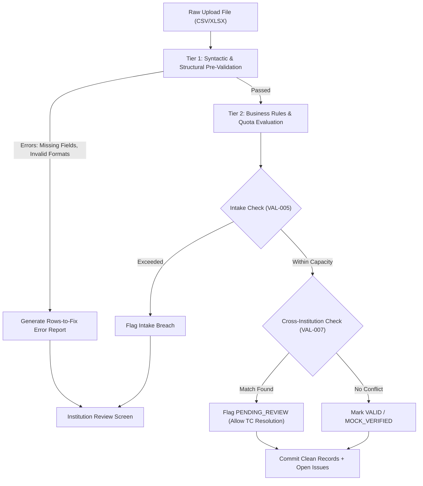

# Validation and Business Rules Engine Specification

This document provides the definitive rule catalogue for Member 3 (Validation & Intelligence) and Member 1 (Frontend error displays). Every rule defines a stable code, triggering criteria, severity, action, and remediation instructions.

---

## 1. Rule Catalogue & Matrix

| Rule Code | Issue Type | Severity | Trigger Condition | System Action | Remediation ("What to do") |
|---|---|---|---|---|---|
| **VAL-001** | `MISSING_APAAR_ID` | `CRITICAL` | `apaar_id` field is blank, empty, or whitespace. | Row rejected from commit. | Enter 12-digit APAAR ID or assist student to generate one via ABC portal. |
| **VAL-002** | `IDENTIFIER_FORMAT_INVALID` | `CRITICAL` | Length $\ne$ 12 digits, contains non-numeric characters, or fails Verhoeff algorithm. | Row rejected from commit. | Correct the 12-digit numeric APAAR format. |
| **VAL-003** | `DUPLICATE_WITHIN_UPLOAD` | `CRITICAL` | Same `apaar_id` or `institution_student_id` appears $\ge 2$ times within the same upload file. | Duplicate rows flagged; source row numbers reported. | Remove duplicate entries from the file and keep only the correct single record. |
| **VAL-004** | `DUPLICATE_WITHIN_INSTITUTION` | `CRITICAL` | `apaar_id` already exists with an `ACTIVE` enrolment in the same institution for the same academic year. | Row rejected. | Check student registration number; student is already enrolled. |
| **VAL-005** | `POTENTIAL_INTAKE_EXCESS` | `CRITICAL` | Total committed regular enrolments $+$ new batch $>$ `approved_seats` (or total $>$ `total_approved`). | Batch held or excess rows flagged. | Review approved intake quota with AICTE or submit request for seat capacity correction. |
| **VAL-006** | `SUPERNUMERARY_QUOTA_EXCEEDED` | `CRITICAL` | Category is `NRI`, `OCI`, `FOREIGN_NATIONAL`, or `SUPERNUMERARY` and exceeds category cap. | Flagged for review. | Verify category entitlement documentation or reclassify seat category. |
| **VAL-007** | `CROSS_INSTITUTION_MATCH` | `REVIEW` | `apaar_id` exists in another institution with `ACTIVE` status in the same academic year. | Record admitted with `PENDING_REVIEW` flag; issue logged. | Upload Transfer Certificate (TC) or clarify dual enrolment with regional AICTE officer. |
| **VAL-008** | `INCONSISTENT_DATES` | `WARNING` | `admission_date` is in the future, prior to academic year start, or preceding student DOB. | Flagged for correction. | Verify and update admission date against college admission register. |
| **VAL-009** | `INTAKE_DATA_MISSING` | `WARNING` | No `ApprovedIntake` record found for `(institution_id, programme_id, academic_year)`. | Enrolment stored; advisory warning to admin. | Contact AICTE Regional Office to input approved intake data for the programme. |
| **VAL-010** | `ANOMALOUS_ENROLMENT_CHANGE` | `WARNING` | Total batch enrolment changes by $> 30\%$ compared to previous academic year. | Marked in AICTE anomaly monitor; not rejected. | AICTE regulatory monitor flags for statistical audit during annual review. |

---

## 2. Validation Engine Execution Flow

When an institution admin uploads a student dataset (CSV or XLSX), the backend executes validation in two synchronous tiers:



---

## 3. Disambiguation Logic for Cross-Institution Enrolments (`VAL-007`)

A core innovation in this platform is avoiding **"false fraud accusations"**. When the same APAAR ID appears across two institutions, the engine evaluates the timeline:

```python
def evaluate_cross_institution_match(new_enrolment, existing_enrolments):
    for prev in existing_enrolments:
        if prev.academic_year == new_enrolment.academic_year:
            if prev.status == "TRANSFERRED" or prev.status == "WITHDRAWN":
                # Legitimate migration
                return IssueClassification(
                    type="LEGITIMATE_TRANSFER",
                    severity="warning",
                    requires_blocking=False,
                    explanation="Student previously transferred or withdrew from prior institution."
                )
            elif prev.status == "ACTIVE":
                # Active conflict — student admitted in two colleges simultaneously
                return IssueClassification(
                    type="POTENTIAL_ACTIVE_ENROLMENT_CONFLICT",
                    severity="review",
                    requires_blocking=False,
                    explanation=f"Active enrolment conflict with {prev.institution_name} (Admitted: {prev.admission_date}). Requires Transfer Certificate review."
                )
    return None
```

---

## 4. Intake Capacity Calculation Logic

For any programme intake check:
$$\text{Available Regular Seats} = \text{Approved Seats} - \sum \text{Active Regular Enrolments}$$
$$\text{Available Supernumerary Seats} = \text{Authorized Supernumerary} - \sum \text{Active Supernumerary Enrolments}$$

1. If $\text{Available Regular Seats} < 0$, fire `VAL-005` with `severity: 'critical'`.
2. Supernumerary categories (`NRI`, `OCI`, `FOREIGN_NATIONAL`, `TFW`) do **not** consume general quota seats, protecting merit candidates.
